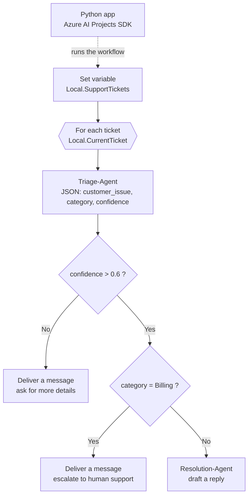

# Prince Hands-on Lab: Build an AI Customer Support Workflow in Microsoft Foundry

Build a **multi-agent workflow** in Microsoft Foundry that triages customer support tickets: one AI agent classifies each ticket with a confidence score, rules route it, billing issues go to a human, and a second agent drafts the reply. Then **run the same workflow from Python** in VS Code with the Azure AI Projects SDK.

| | |
|---|---|
| **Level** | Intermediate (300) |
| **Time** | About 60 minutes |
| **Cost** | About US $0.20 if you [clean up](docs/09-cleanup.md) |
| **For** | AI engineers, developers, data scientists |
| **You need** | An Azure subscription (Free Trial works), VS Code, Python 3.13, Git, Azure CLI |

## Scenario

*ContosoPay*, a fictional B2B payments and invoicing platform, receives support tickets about API errors, invoice exports and duplicate charges. Your workflow processes every ticket the same way:



## Lab steps

Every page is click by click. Do them in order.

| # | Step | What you do |
|---|---|---|
| 0 | [Overview and key concepts](docs/00-overview-and-concepts.md) | Foundry, workflows, agents, structured output |
| 1 | [Prerequisites and cost](docs/01-prerequisites-and-cost.md) | Check tools (Python **3.13**, not 3.14), set a budget alert |
| 2 | [Create a Foundry project](docs/02-create-foundry-project.md) | Project, resource group, model deployment |
| 3 | [Create the workflow and loop](docs/03-build-the-workflow.md) | Blank workflow, ticket array, for-each |
| 4 | [Triage Agent](docs/04-triage-agent.md) | JSON Schema output, instructions, input/output variables |
| 5 | [Conditions and routing](docs/05-conditions-and-routing.md) | Low-confidence handling, billing escalation |
| 6 | [Resolution Agent and preview](docs/06-resolution-agent-and-preview.md) | Draft replies, test in the portal |
| 7 | [Run from code](docs/07-run-from-code.md) | VS Code, virtual environment, `.env`, `workflow.py` |
| 8 | [Share your learnings](docs/08-share-your-learnings.md) | Screenshots and a LinkedIn post |
| 9 | [**Clean up**](docs/09-cleanup.md) | Delete the resource group |
| 10 | [Troubleshooting](docs/10-troubleshooting.md) | Fixes for every common error |
| 11 | [Interview questions](docs/11-interview-questions.md) | Explain the work in an interview |

## Repository layout

```
foundry-ai-workflow-lab/
├── README.md
├── docs/                         ← the click-by-click guide (steps 0–11)
├── workflow-inputs/              ← every value to paste into the portal, ready to copy
│   ├── support-tickets.json
│   ├── triage-response-format.json
│   ├── triage-agent-instructions.txt
│   ├── resolution-agent-instructions.txt
│   └── conditions-and-messages.txt
└── Python/
    ├── workflow.py               ← starter: you complete it in step 7
    ├── solution/workflow.py      ← finished version
    ├── requirements.txt
    └── .env.example              ← copy to .env and paste your project endpoint
```

## What's fixed compared with the original exercise

| Problem you'd hit | Fix in this repo |
|---|---|
| Code blocks were pasted at the wrong indentation, causing `IndentationError` inside the `with` block | Every snippet shows its exact indentation, the starter marks where each block goes, and a finished `solution/workflow.py` is included |
| Guide said *"Connect to the agents client"* but the file says *Connect to the AI Project client* | Comments and guide match |
| Workflow name hard-coded in the code; any naming difference meant a "not found" error | Name read from `WORKFLOW_NAME` in `.env` |
| Portal shows `AZURE_EXISTING_AIPROJECT_ENDPOINT`, code expects `PROJECT_ENDPOINT` | Code accepts either, and stops with a clear message if the endpoint is missing |
| `.env` with a placeholder was committed in the repo | `.env.example` + `.gitignore`, so your endpoint is never pushed |
| Python 3.14 breaks `pip install` | Prerequisites require 3.13 (or 3.12) and show how to check |
| `Activate.ps1` blocked: *running scripts is disabled* | `Set-ExecutionPolicy -Scope Process` line included |
| Troubleshooting used `rmdir /s /q`, which fails in PowerShell | `Remove-Item -Recurse -Force` (and macOS/Linux commands) |
| No model deployment check: agents created with no model | Step 2 checks and deploys a model |
| *"Unknown values"* error when JSON Schema wasn't applied | Explicit check in step 4 plus a troubleshooting entry |
| Guide text said the Billing branch "drafts a response for non-billing tickets" | Corrected: the If branch escalates billing; the Else branch drafts replies |
| Raw, hard-to-read console output; crashes on unexpected output | Formatted per ticket, with fallback to raw text and a clear message if the run fails |
| Clean up pointed to a fixed resource group name you may not have | Dedicated `rg-prince-workflow`, plus how to find yours |
| Long values typed from screenshots or PDFs (smart quotes, broken JSON) | All values in `workflow-inputs/`, copy-paste safe |

## Documentation

- Microsoft Foundry: <https://learn.microsoft.com/azure/ai-foundry/>
- Workflows in Microsoft Foundry: <https://learn.microsoft.com/azure/foundry/agents/concepts/workflow>
- Azure AI Projects SDK for Python: <https://learn.microsoft.com/python/api/overview/azure/ai-projects-readme>
- Pricing: <https://azure.microsoft.com/pricing/details/ai-foundry/>

> The workflow builder in Microsoft Foundry is in **preview**. Labels in the portal can change; if a button name differs, look for the closest match and check [Troubleshooting](docs/10-troubleshooting.md).

## Summary

In this lab you:

- **Created a Microsoft Foundry project** with a model deployment.
- **Built a support triage workflow** with a variable, a for-each loop, two If/Else conditions and message nodes.
- **Created a Triage Agent** that returns **strict JSON** (category + confidence).
- **Routed tickets**: low confidence → ask for details; Billing → human escalation; others → AI reply.
- **Created a Resolution Agent** that drafts professional replies.
- **Ran the workflow from Python** with the Azure AI Projects SDK and Entra ID sign-in.
- **Cleaned up** all Azure resources.

---

*Prince Hands-on Labs. Based on Microsoft Learn's open-source exercise ([MicrosoftLearning/mslearn-ai-agents](https://github.com/MicrosoftLearning/mslearn-ai-agents)), MIT licence (see [LICENSE](LICENSE)), updated and fixed for classroom use. ContosoPay is a fictional company.*
