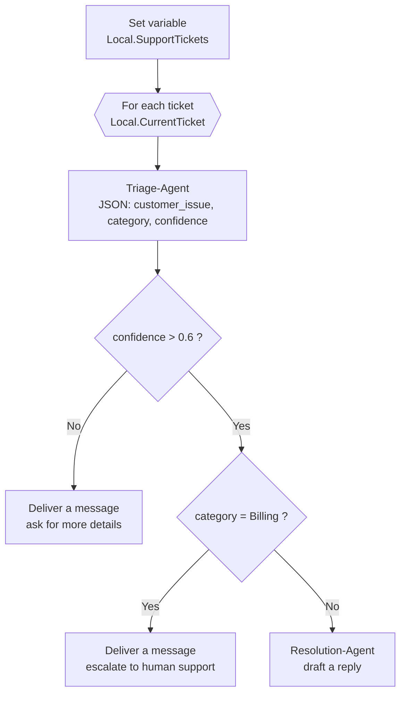

# 0 · Overview and key concepts

[⬅ README](../README.md) · [Next: Prerequisites and cost ➡](01-prerequisites-and-cost.md)

## What you'll build

A **customer support triage workflow** for *ContosoPay*, a fictional B2B payments and invoicing platform. The workflow reads a list of support tickets and, for each one:

1. a **Triage Agent** classifies it as **Billing**, **Technical** or **General**, with a confidence score, as strict JSON;
2. **low-confidence** tickets get a "please send more details" message;
3. **Billing** tickets are **escalated to a human** (money problems shouldn't be answered by AI alone);
4. **Technical** and **General** tickets get a drafted reply from a **Resolution Agent**.

Then you run the same workflow **from Python** in VS Code, the way a real application would call it.

## Key concepts

| Concept | What it means here |
|---|---|
| **Microsoft Foundry** | Azure's platform to build, test and deploy AI apps and agents. A **project** groups your models, agents and workflows. |
| **Workflow** | A visual sequence of steps (nodes): variables, loops, conditions, messages and agent calls. Built with no code in the portal. |
| **Agent** | A model plus instructions (and optionally tools) that does one job. Here: one agent classifies, another writes replies. |
| **Structured output (JSON Schema)** | Forces the Triage Agent to return valid JSON with exactly the fields you define, so later nodes can read `confidence` and `category` reliably. |
| **Variables** | Values the workflow passes between nodes, e.g. `Local.CurrentTicket`, `Local.TriageOutputJson`. |
| **Project endpoint** | The URL your code uses to reach your Foundry project. |
| **Azure AI Projects SDK** | The Python library (`azure-ai-projects`) that connects to the project and runs the workflow from code. |

## Why this design is production-minded

- **Deterministic routing around a probabilistic model**: the model classifies; plain conditions decide what happens next.
- **Confidence threshold**: uncertain answers don't get an automatic reply.
- **Human in the loop for money**: billing issues always go to a person.
- **Strict schema**: no fragile text parsing between steps.
- **Callable from code**: the same workflow serves the portal and your application.
